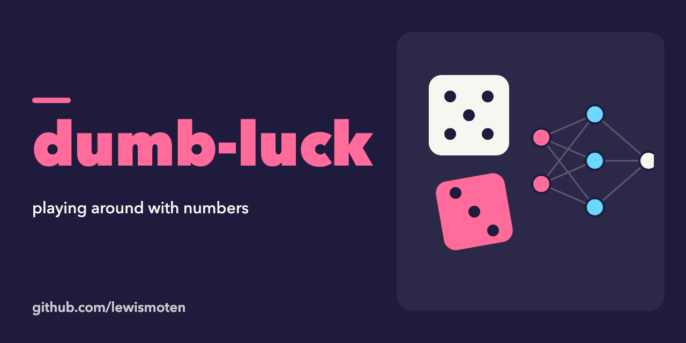

# dumb-luck

Playing around with numbers in Node.js.

- `index.js` trains a small neural network (the `neuralnet` package) to play tic-tac-toe. Its layers are saved in `layers.json`.
- `pick3.js` is a follow-up experiment that feeds a history of numbers to a network to predict the next draw (`pick3.layers.json`).

Status: experiment from 2019, not maintained.

## Run

```sh
npm install
node index.js
```

## License

MIT. See [LICENSE.md](LICENSE.md).
